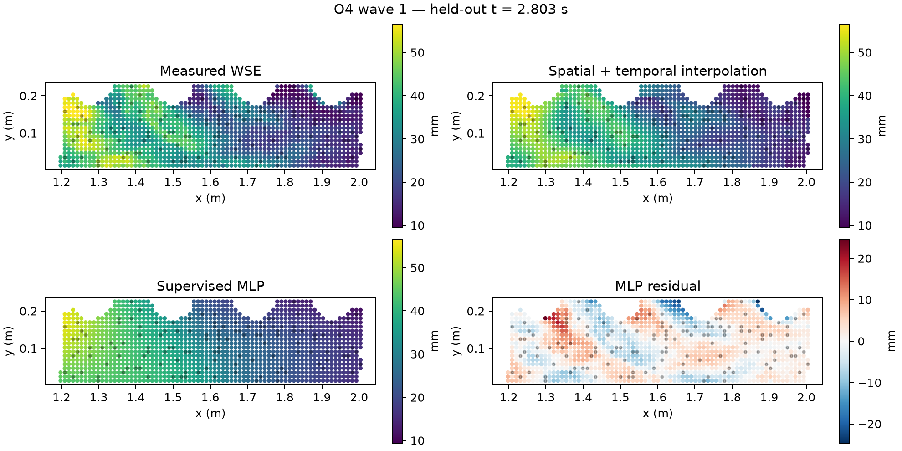
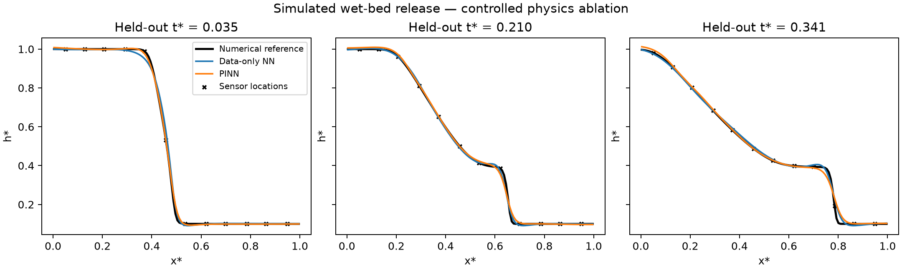

# Initial benchmark results

These are executed results, not projected performance. The measured run used seed
42 and 1500 optimizer steps; the synthetic ablation
used seed 42 and 1500 steps per model.
One seed does not establish research superiority.

## Measured O4 wave 1

128 sampled grid locations serve as virtual sensors. Their WSE values are used
at 73 training frames; 24 frames are
reserved for model selection. Final evaluation uses 23 other frames
at 1151 spatial locations that were not sensors.
The task is within-wave reconstruction, not forecasting a new disaster.

| Model | WSE RMSE (mm) | WSE MAE (mm) |
| --- | ---: | ---: |
| Linear spatial and temporal interpolation | 3.442 | 2.042 |
| Supervised coordinate MLP | 4.735 | 3.248 |

The interpolation baseline has lower error in this run. The measured-data model currently has no
PDE loss: evolving bed elevation and velocity have not been observed during the wave.

Source: Segovia-Burillo et al., [Zaragoza dataset](https://zenodo.org/records/17777387),
[CC BY 4.0](https://creativecommons.org/licenses/by/4.0/). Changes: unit conversion,
masking, spatial subsampling, simulated observation removal, and reconstruction plots.

## Frozen wave 1 to wave 3 transfer

The models receive no wave 3 observations for fitting. Evaluation matches spatial coordinates
and restricts time to the wave 1 training interval: 117 frames,
1273 locations. The frozen MLP RMSE is
6.716 mm; frozen source interpolation RMSE is
6.799 mm.
This is a test across waves in the same laboratory geometry with a changed bed, not across
independent Himalayan events. Higher error suggests that within-wave accuracy does not
establish transfer performance.

## Simulated shallow-water PINN ablation

Both networks receive the same simulated height observations at 12 virtual sensor locations,
plus the same known initial and boundary height/discharge conditions. Initial weights and
observation minibatches match. The PINN additionally receives continuity and momentum losses.
Checkpoints are selected using validation height error; test interior values are held out.

| Model | Height RMSE (dimensionless) | Discharge RMSE (dimensionless) | Continuity residual RMS | Momentum residual RMS |
| --- | ---: | ---: | ---: | ---: |
| Data-only NN | 0.01001 | 0.10734 | 0.97741 | 0.68763 |
| PINN | 0.01136 | 0.01610 | 0.16597 | 0.19703 |

In this run, physics improves discharge inference and conservation residuals, while height
reconstruction is slightly worse. Discharge truth is available only because this benchmark
is simulated. Residual reduction alone does not establish predictive accuracy.

The conservative reference solver's mass-balance error is
-1.77e-17 in dimensionless units.
Refining from 128 to 256 cells changes final height by an RMSE of
0.00841; numerical
reference error is material relative to network error. Strong-form PINNs also smooth shocks.

## Scope of the evidence

The pipeline runs on real laboratory observations and the PINN passes a controlled numerical
benchmark. It has not been validated on Nepal floods, glacier failure, debris flows,
wetting/drying, sediment transport, or a real warning system. Next experiments must examine
multiple seeds, reduced sensor budgets, weak conservation losses, and physics mismatch.
