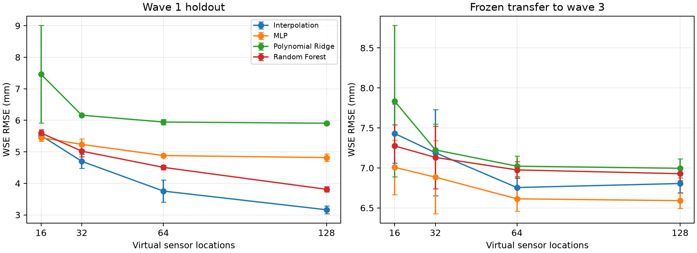

# Executed sensor-budget study

Twelve measured-data runs: four budgets × three seeds, four models per run.
Each MLP receives 1,500 optimizer steps. The split uses nested sensor sets and
fixed held-out locations across budgets within a seed. Models and checkpoints are
selected on validation RMSE; the following results are descriptive test summaries.

| Sensors | Interpolation RMSE (mm) | MLP RMSE (mm) |
| ---: | ---: | ---: |
| 16 | 5.52 ± 0.12 | 5.45 ± 0.12 |
| 32 | 4.70 ± 0.22 | 5.24 ± 0.18 |
| 64 | 3.76 ± 0.35 | 4.88 ± 0.04 |
| 128 | 3.16 ± 0.13 | 4.82 ± 0.12 |

Values are mean ± sample standard deviation across seeds 42, 43, and 44. The small
MLP advantage at 16 sensors does not establish statistical superiority. At 128
sensors, frozen wave 3 transfer has mean RMSE 6.59 ± 0.09 mm for the MLP and
6.80 ± 0.11 mm for interpolation. The study uses one laboratory configuration;
seed variability is not variability across independent flood events.

- `runs.csv`: all validation, test, and transfer results with seed/budget metadata.
- `summary.csv`: per-budget/model means, sample standard deviations, and seed counts.
- `protocol.json`: notebook and data SHA-256s, training steps, seeds, and split design.

Reproduce with `floods sensor-ablation`. See [protocol](../../docs/sensor_ablation.md)
and the [executed result notebook](../../notebooks/sensor_ablation.ipynb).
The reference showcase uses a different random sensor sampling design.

Source observations: Segovia-Burillo et al.,
[Zenodo 17777387](https://zenodo.org/records/17777387),
[CC BY 4.0](https://creativecommons.org/licenses/by/4.0/).
Derived plot changes: masking, subsampling, sparse-observation reconstruction,
and aggregate evaluation. Attribution and processing are in
[data provenance](../../docs/data_sources.md).
